# 视频流分流获取

1. 打开 DWI assistant 软件，在左上角输入机器人的 IP 地址（IP 地址可通过 dwii 控制软件查看，或者直接在路由器管理页面查看）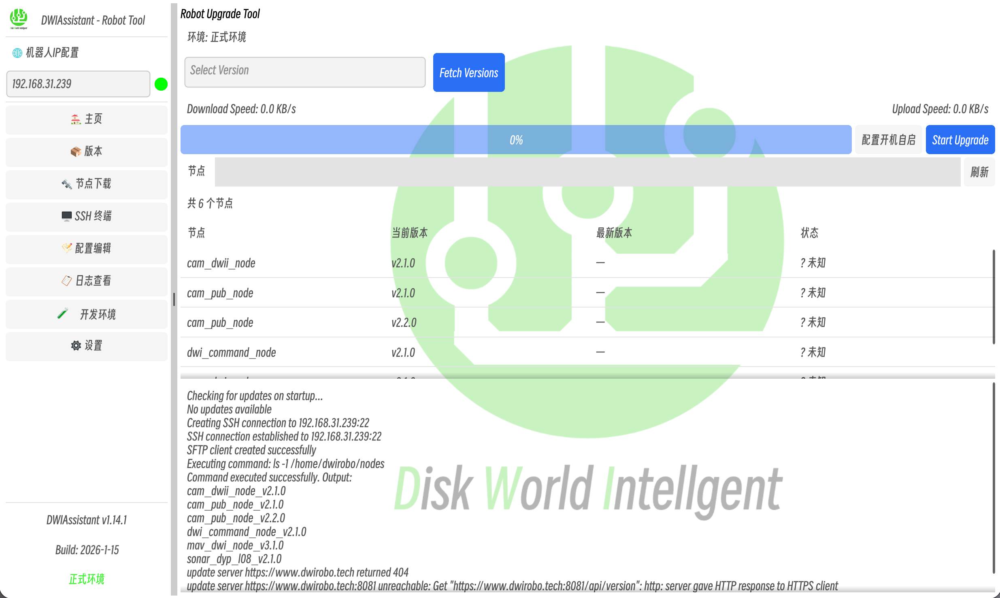
2. 点击 fetch version，选择视频流获取的这个版本；
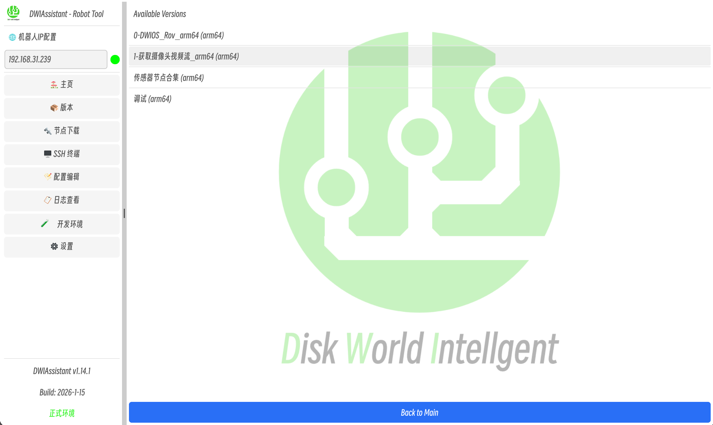
3. 点击 start upgrade 按钮开始更新节点；
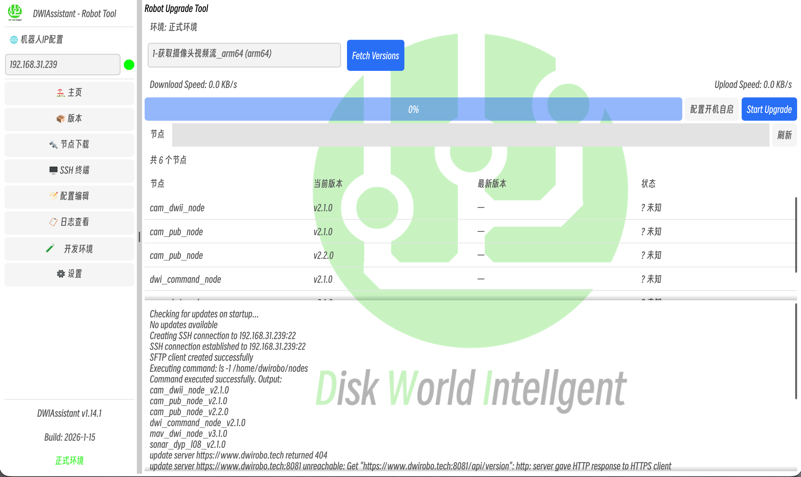
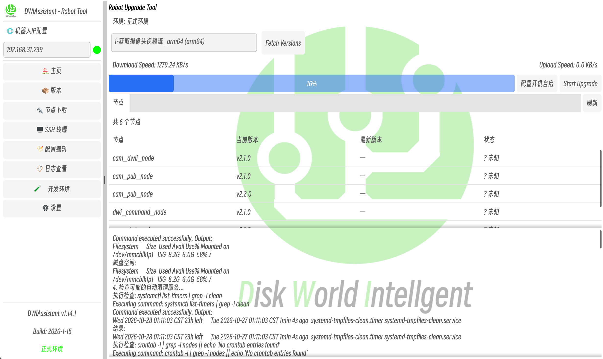
4. 等待进度条运行到百分之百，弹出完成更新节点的窗口；
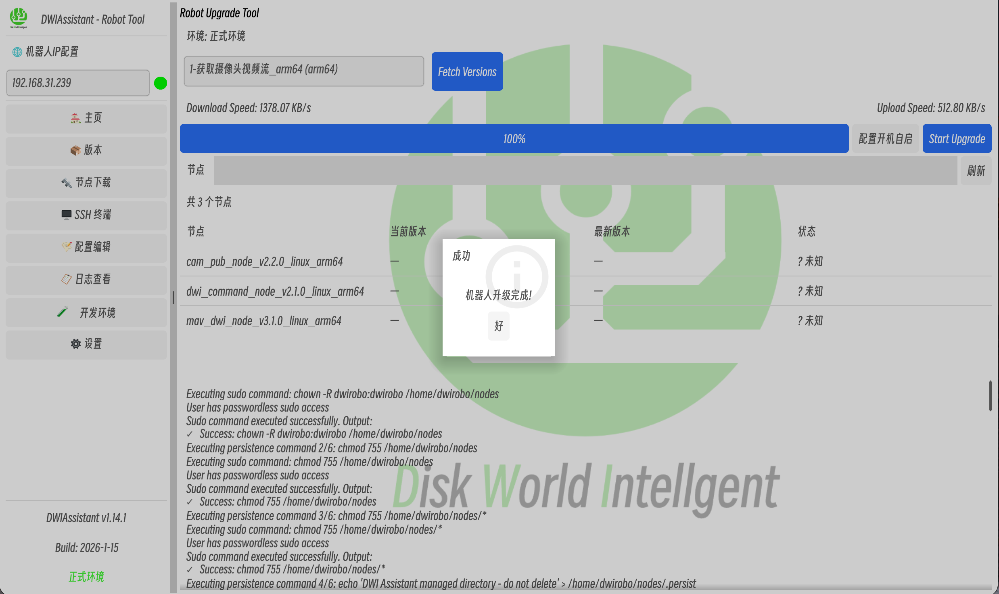
5. 完成后进入左侧的进入配置编辑页后，点击“加载配置”，然后将下面 QGC 的 IP 地址改为用户电脑的 IP 地址（即 QGC 运行的那台电脑的 IP 地址），端口号不要修改；
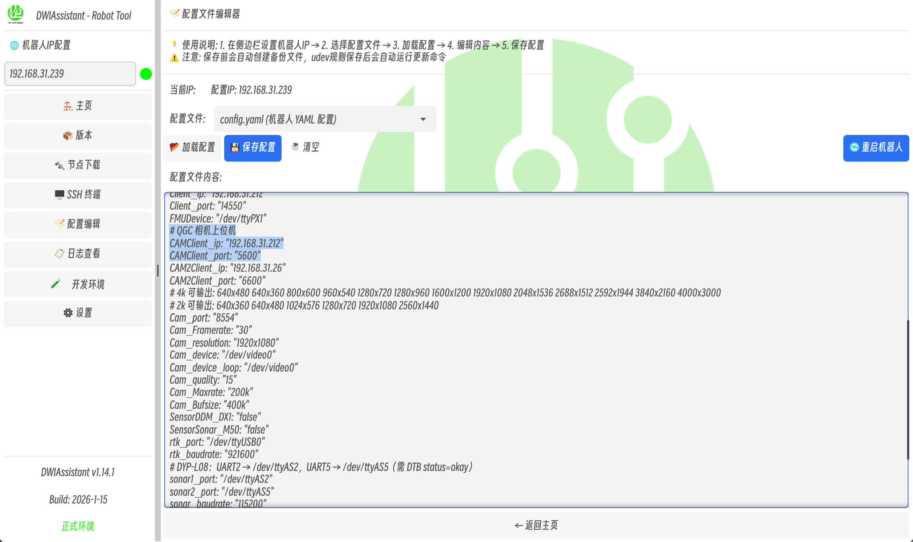
6. 点击保存配置，点击是等待检查保存，保存成功后会有提示；
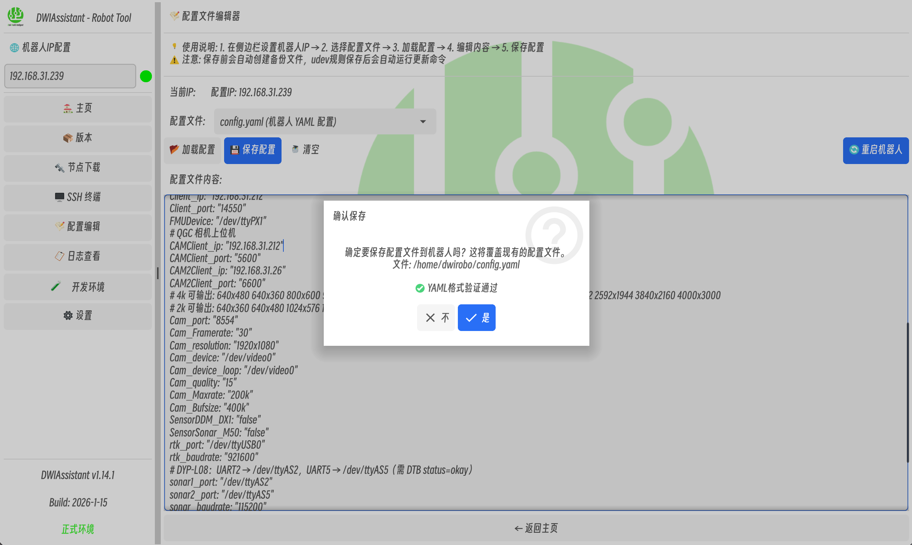
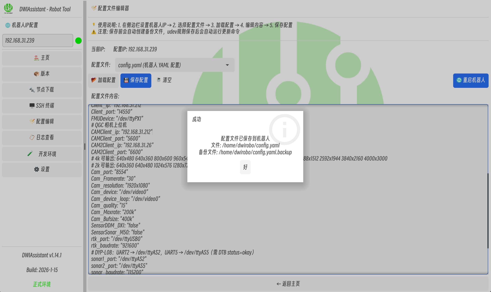
7. 点击重启机器人，点击是
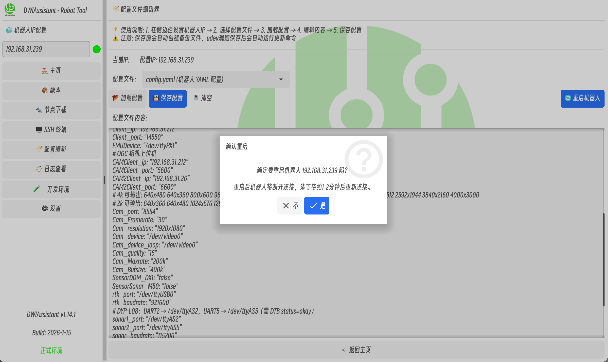
8. 等待机器人重启，打开 QGC 软件，进入设置 video，将视频源改为 UDP H.264
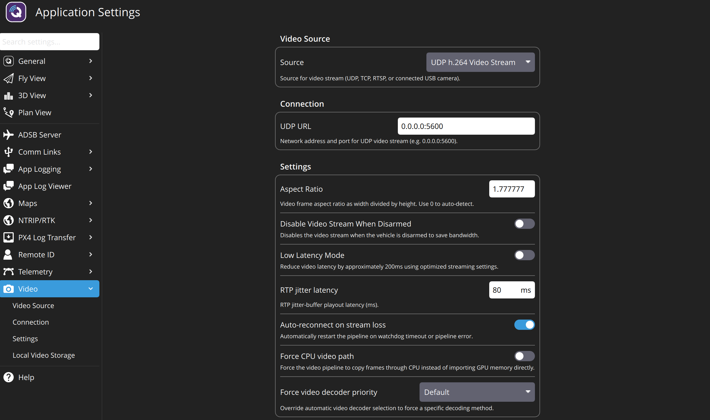
9. 回到 QGC 主页，机器人启动后会自动将视频流推送到 QGC 的 5600 端口

10. 用户获取视频源视频流的方法和 QGC 获取视频流的方式是一样的，视频流格式为 UDP H264
11. 视频流分流已成功！
12. 可通过 DWI node mapper 查看机器人节点的运行情况
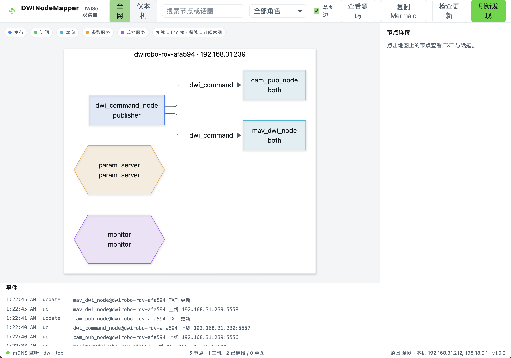